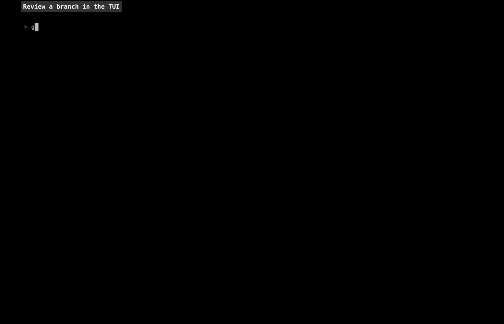

# gr

Local, GitHub-style code review for git. Review in the TUI. Agents and editors use the CLI.



Reviews live in one SQLite database (`$XDG_DATA_HOME/gr/gr.db`), keyed by each repo's root commit,
so every clone and worktree of a repo sees the same reviews.

## Install

### Via mise

```
mise use -g github:chancez/gr
```

### With go install

```
go install github.com/chancez/gr/cmd/gr@latest
```

It needs Go 1.27 or newer, which `go` fetches itself unless `GOTOOLCHAIN=local`.

### Manually

Download the archive for your OS and architecture from the
[releases](https://github.com/chancez/gr/releases), check it against `checksums.txt`, and put the
`gr` in it on your PATH. Or, for the latest release into `~/.local/bin`:

```
os=$(uname -s | tr '[:upper:]' '[:lower:]')
arch=$(uname -m | sed 's/x86_64/amd64/; s/aarch64/arm64/')
curl -fsSL "https://github.com/chancez/gr/releases/latest/download/gr_${os}_${arch}.tar.gz" |
  tar -xz -C ~/.local/bin gr
```

### From source

```
mise install
mise run install    # -> ~/.local/bin/gr
```

## Review in the TUI

```
gr                  # the current branch against the default branch
gr feature          # a branch
gr main..feature    # a fixed range
gr abc123           # one commit
```

The default branch is the base remote's HEAD, or its `main` or `master`. The base remote is
`checkout.defaultRemote` or `clone.defaultRemoteName` when set, then `origin`, `upstream`, the only
remote, or the one that is not `remote.pushDefault`. A local branch of the same name is used instead
unless it is only behind the remote's. A branch stacked on another local branch is based on that
one. `--base` overrides it, and a change remembers its base. To move a change onto another base
later, pass a different `--base`, run `gr change base <branch>`, or press `B` in the TUI. A change
follows its branch through `git branch -m`, and for a branch copied with `git branch -c` the TUI
asks whether it should. To move one onto another branch yourself, run
`gr change branch <change>` on that branch. The overview shows these moves among the reviews,
`gr change show` lists them, and a branch's old name still finds its change.

A change is merged once its commits are on its base, or copies of them are, as a rebase merge
makes; the TUI notices while open. A branch
emptied some other way, as reset after a squash merge, leaves its change open, and the TUI asks
whether it merged or was abandoned. Once a change is closed, new commits on its branch are a new
change's, which the TUI offers to open.

The sidebar lists the overview, the changes since your last review once the branch has moved, each
commit, and the whole diff, with the selected one's files below. The overview is the conversation:
every review, its summary, and its threads with the code they are on. `?` lists every key. The most used:

| Key | Action |
| --- | --- |
| `j` `k` `d` `u` `g` `G` | move |
| `h` `l`, `tab` | sidebar and diff; `ctrl+j` `ctrl+k` between sidebar lists |
| `}` `{`, `]` `[`, `J` `K`, `)` `(` | next or previous commit, file, hunk, change |
| `H`, `A` | overview, all changes; again to go back |
| `/`, `n` `N` | search, next or previous match |
| `t` `T` | next or previous thread |
| `zo` `zc` `za` `zR` `zM` | open, close, toggle folds; open or close all |
| `c` | comment on the line, selection, file, or change |
| `v` | start or end a line selection |
| `C` | comment on the whole file or commit |
| `r` `x` `a` | reply, resolve or reopen, mark addressed or reopen; replying to an addressed thread reopens it |
| `m` `M`, `+` | mark the file or commit reviewed; toggle moving on to the next unreviewed |
| `F` | filter the overview's threads by state |
| `S` | submit your review: approve, request changes, or comment |
| `s` | toggle split diff |
| `B` | pick another base branch for the change, as for a stacked branch: type to filter, click or enter to pick |
| `w`, `ctrl+t` | switch to another change of this repository, or open any repository's in a new tab |
| `ctrl+w`, `ctrl+pgdn` `ctrl+pgup`, `alt+1`..`9` | close the tab, next or previous tab, go to a tab |
| `ctrl+shift+pgdn` `ctrl+shift+pgup` | move the tab right or left; drag a tab's label to move it, and click its `x` to close it |

Comments are Markdown. `ctrl+e` writes one in `$EDITOR`. In the comment box, a click places the
cursor and a drag selects, as shift with the arrows does; `ctrl+shift+c` copies the selection.
In a diff, dragging over code selects its text, the code alone: letting go copies it to the
clipboard, through the terminal, and selects its lines, so `c` comments on them. It stays as the
view scrolls, and goes as the cursor moves. Quitting remembers where you were in a change, the view,
the line, folds, and split, and opening it again goes back there.

Colors follow the terminal's light or dark background. `GR_THEME=colorblind` uses blue and orange in
place of green and red.

Symbols are Unicode by default, and Nerd Font icons in terminals that bundle them: kitty, WezTerm,
and Ghostty, recognized by their answer to XTVERSION or their environment. A font's glyphs cannot be
detected, so elsewhere set `GR_GLYPHS=nerd` if your font is a Nerd Font, or `GR_GLYPHS=ascii` for
plain ASCII.

## Config

Settings live in `$XDG_CONFIG_HOME/gr/config.toml`, by default `~/.config/gr/config.toml`, or
wherever `GR_CONFIG` points. Every setting is optional; an unknown one is an error.

```toml
[ui]
theme = "colorblind"   # or "default"; GR_THEME overrides it
glyphs = "nerd"        # "ascii", "unicode", or "nerd"; unset picks from the terminal; GR_GLYPHS overrides it
scrolloff = 5          # lines kept between the cursor and the diff's edges
sidebar_width = 30     # columns, until the divider is dragged
auto_advance = true    # move on to the next unreviewed file after marking one reviewed

[editor]
vim = true             # vim's modes in the comment box: esc to normal mode, esc again to close
```

## For agents

Two skills teach an agent gr: `gr` addresses a review's threads, and `gr-review` reviews a change.

### Install the skills

With the [skills](https://github.com/vercel-labs/skills) CLI, for every project:

```
npx skills add chancez/gr -g -a claude-code -a codex
```

Or by hand, into `~/.claude/skills` for Claude Code or `~/.agents/skills` for Codex:

```
dir=~/.claude/skills    # or ~/.agents/skills
mkdir -p "$dir"
curl -fsSL https://github.com/chancez/gr/archive/refs/heads/main.tar.gz |
  tar -xz -C "$dir" --strip-components=2 gr-main/skills/gr gr-main/skills/gr-review
```

### Use gr from an agent

Every data command takes `--json`. Commands that only read, as `gr change list`, `gr change show`,
and `gr threads`, first ask git whether changes moved or landed, so a branch merged since gr last
looked lists as merged; `--sync=false` reads what is recorded. Set `GR_AUTHOR` to your agent's name. Under an agent, as
Claude Code, gr refuses to write as your git identity without it.

```
gr threads --state open --json             # what the reviewer asked for, with the code each is on
gr reply 3 -m "Fixed in the next commit."
gr address 3                               # for the reviewer to confirm and resolve
gr threads --commit HEAD --json            # threads on one commit, in any change
```

Reviewing works the same way:

```
gr comment --commit HEAD -p main.go -l 10-12 -m "This can be nil."
gr comment --commit HEAD -p /COMMIT_MSG -l 1 -m "Subject is too long."
gr comment -p main.go -l 4 -m "On the whole diff."
gr comment -m "Top-level comment."
gr mark --commit HEAD                      # reviewed; -p for a file, gr change show lists marks
gr submit --request-changes -m "Summary."
```

## Docs

- [docs/design.md](docs/design.md): what gr does and why
- [docs/architecture.md](docs/architecture.md): how the code is laid out
- [docs/adr](docs/adr): decisions
- [GLOSSARY.md](GLOSSARY.md): terms
- [TODO.md](TODO.md): planned work
